# Mapa pedagógico y dinámicas

Qué enseña **Árbol de Problemas · Expedición** (proyecto de Juan Pablo Peláez Pino) y cómo lo enseña. Escrito por Claude en la auditoría del 18-11-2026 a partir del código (`dac9c20`), las guías PDF y pruebas en la app publicada.

> Nota de rigor: el proyecto no declara una metodología pedagógica formal. Aquí se describen las **decisiones de diseño que se ven en el código** y qué aprendizaje pueden favorecer; no se atribuyen teorías que el autor no citó.

## 1. Qué problema educativo ataca

El árbol de problemas y el análisis AS-IS suelen enseñarse con una diapositiva terminada. El riesgo es que el estudiante memorice el dibujo sin entender **de dónde salen las causas**, por qué van en cuatro columnas y por qué el árbol **no lleva soluciones**. El autor lo resume en su guía: «un árbol de problemas se entiende de verdad cuando uno lo construye».

## 2. Contenido académico que cubre

| Bloque | Conceptos |
|---|---|
| Sistema y análisis | Sistema, organización, mundo real vs. mundo de la solución, AS-IS, límites (geográfico, organizacional, de proceso, temporal), objetivos, subsistemas |
| Modelo del sistema | Entradas (4), procesos (6), salidas (3, la que falla: evidencia de origen), control (normativa, indicadores, retroalimentación), entorno |
| Árbol de problemas | Suelo = entorno, raíces = causas, tronco = problema central (una sola situación negativa en términos del sistema), copa = efectos directos (4), indirectos (3) y final (1); lectura de abajo hacia arriba |
| Cuatro dimensiones | Actores (¿quién participa?), Datos (¿qué información?), Procesos (¿qué se hace?), Control (¿cómo se evalúa?); truco A-D-P-C |
| Datos | Dato → información → conocimiento; variables cuantitativas y cualitativas; fuentes actuales |
| Factibilidad y viabilidad | Factible = ¿se puede? (técnica, operativa, económica, legal); viable = ¿vale la pena y se sostiene? (necesidad, momento, impacto, riesgos); matriz de 4 cuadros |
| Modelado | DFD (entidad externa, proceso, almacén, flujo; reglas de conexión; nivel 0 y nivel 1) y DFP estilo Bizagi/BPMN (inicio, tarea, compuerta, fin, flujo de secuencia, carriles, camino «No») |
| Caso real | Pasaporte Verde del Predio Amazónico: acreditación de origen en el Caquetá, Reglamento (UE) 2023/1115, actores reales (ICA, IDEAM, CORPOAMAZONIA, ANT, IGAC, Comité de Ganaderos, ASOHECA, Fedegán, Fedecacao, Casa Luker, Nacional de Chocolates, SINCHI, Unión Europea…) |

## 3. El hilo narrativo: Don Arley

Don Arley (ficticio, el juego lo dice) es un cacaotero de Cartagena del Chairá cuyo lote de cacao se rechaza en Europa aunque él no deforestó. La historia cumple tres funciones:

1. **Crea la pregunta** antes de dar la teoría: «¿por qué lo rechazaron?».
2. **Convierte las causas en hallazgos**: las 12 fallas aparecen en las 7 paradas del camino (Producir → Documentar → Movilizar → Acopiar → Acreditar → Comercializar → Comprador UE) y el estudiante las clasifica.
3. **Hace visible el árbol**: las fichas clasificadas suben y se vuelven raíces; crece el tronco y la copa. Solo entonces se dice «esto es un árbol de problemas».

Orden real de los capítulos dentro del mapa:
1. **El viaje del lote** (fase Descubrir) — antes de la misión 1.
2. **Revisar el camino** (Experimentar + Observar) — después de «Entrada, proceso, salida y control».
3. **Nace el árbol** (Comprender + laboratorio) — después de «Ceibita dice».
4. **Otro sistema** (Aplicar: caso inventado de la biblioteca) — después de «El entorno».
5. **Demuéstralo** (Demostrar: 8 piezas + 3 preguntas de «por qué») — antes de «Factibilidad y viabilidad».

Los nombres de las fases (Descubrir, Experimentar, Observar, Comprender, Aplicar, Demostrar) muestran una **secuencia deliberada**: vivir el caso, explorarlo, ver el patrón, nombrar el concepto, transferirlo y demostrarlo.

## 4. Recorrido del estudiante en la Expedición

```mermaid
flowchart LR
  C1["🎬 Cap. 1<br/>El viaje del lote"] --> M1["1 El sistema"] --> M2["2 Entrada, proceso,<br/>salida y control"] --> C2["🛤️ Cap. 2<br/>Revisar el camino"]
  C2 --> M3["3 Actores"] --> M4["4 Datos"] --> M5["5 Procesos"] --> M6["6 DFD"] --> M7["7 DFP Bizagi"] --> M8["8 Control"] --> X["🕺 Ceibita dice"]
  X --> C3["🌳 Cap. 3<br/>Nace el árbol"] --> M9["9 Cómo se lee el árbol"] --> M10["10 Problema central"] --> M11["11 Efectos"] --> M12["12 Entorno"]
  M12 --> C4["📚 Cap. 4<br/>Otro sistema"] --> C5["🏆 Cap. 5<br/>Demuéstralo"] --> M13["13 Factibilidad<br/>y viabilidad"] --> M14["👑 14 Jefe final"]
  M13 -. invitación .-> S1["Reto del salón<br/>factibilidad"]
  M14 -. invitación .-> S2["Reto del salón<br/>árbol"]
```

Cada misión sigue el mismo patrón: **Ceibita explica** (3-7 tarjetas cortas leídas en voz alta e iluminadas) → **minijuegos** para fijar → **batalla** de preguntas contra un monstruo con nombre del tema (Neblina, Caja Negra, El Intermediario, Papelito Perdido, Trámite Infinito, Ojo Ciego, Raíz Torcida, Enredo, Motosierra, Sin Señal, El Imposible, El Dato Perdido, El Cuello de Botella, El Gran Desarticulado).

## 5. Las dinámicas (qué hace cada una y qué aporta)

| Dinámica | Cómo se juega | Tipo de aprendizaje | Dónde se usa | Archivo / función | Estado |
|---|---|---|---|---|---|
| Explicación de Ceibita | Tarjetas cortas; la voz lee e ilumina bloque por bloque | Presentación del concepto, doble canal (oír y ver) | Todas las misiones | `RUN.talk`, `leerBloques` | VERIFICADA |
| Enlazar con hilos | Hilo desde la tarjeta a su grupo (o tocar y tocar) | Clasificación con feedback inmediato | Sistema, Modelo, Factibilidad | `RUN.enlazar` | VERIFICADA |
| Armar el árbol | Arrastrar tarjetas a capas con forma de árbol | Clasificación espacial: la posición ES el concepto | Problema, Efectos, Entorno | `RUN.armar` | VERIFICADA (por clic) |
| Lanzamiento | Resortera con física hacia canastas | Clasificación con habilidad motora | Datos | `RUN.lanzar` | VERIFICADA (tecla 1; sin arrastre real) |
| Lluvia de tarjetas | Mover la tarjeta que cae a su caja | Clasificación con presión de tiempo | Ninguna misión actual | `RUN.lluvia` | IMPLEMENTADA, sin uso |
| Atrapa con la canasta | Solo atrapar lo de una categoría | Discriminación sí/no | Sistema, Modelo, Actores, Datos, Efectos, Entorno, Factibilidad | `RUN.catch` | VERIFICADA (pausa) |
| Memoria | Parejas concepto–definición | Asociación y recuerdo | Árbol, Datos, Procesos, Factibilidad | `RUN.memory` | VERIFICADA |
| Unir | Pareja izquierda–derecha | Asociación | Árbol, Actores, Datos, Procesos, Control, Efectos, DFD, DFP | `RUN.match` | VERIFICADA |
| Ordenar | Tocar en orden | Secuencia (lectura del árbol, cadena de exigencia, procesos, problema central) | Árbol, Actores, Procesos, Problema | `RUN.order` | VERIFICADA |
| Verdadero o falso | Afirmación y porqué | Corrección de ideas erróneas | Control, DFD, DFP | `RUN.tf` | VERIFICADA |
| Relámpago | ¿La respuesta mostrada es correcta? contra reloj | Recuperación rápida | Problema, Control, Factibilidad, Jefe | `RUN.speed` | VERIFICADA (error menor E5) |
| Construir el árbol | 20 piezas en su lugar (12 causas, 4 directos, 3 indirectos, final) | Síntesis de todo el árbol | Jefe | `RUN.build` | VERIFICADA (20/20; desborde móvil E4) |
| Batalla | Preguntas de opción múltiple; corazones y vida del monstruo | Evaluación con explicación; alimenta el repaso | Todas | `battle()` | VERIFICADA |
| Construye el DFD | 1) nombrar símbolos 2) clasificar piezas 3) conectar flechas; reglas validadas | Modelado de datos | DFD | `DG.motor` + `DFD_CFG` | VERIFICADA (con error E1) |
| Modela como en Bizagi | Igual, con carriles y compuerta Sí/No | Modelado de procesos | DFP | `DG.motor` + `BP_CFG` | VERIFICADA |
| Matriz factible/viable | Cada caso a uno de 4 cuadros; pista por eje | Distinguir dos criterios a la vez | Factibilidad | `MATRIZ.jugar` | VERIFICADA |
| Voltea y decide | ¿Factibilidad o viabilidad? y la carta se voltea con el porqué | Discriminación de conceptos vecinos | Factibilidad | `VOLTEA.jugar` | VERIFICADA |
| Ceibita dice | Un gesto del cuerpo por parte del árbol; juego de «Simón dice» | Aprendizaje con el cuerpo, ancla para exponer | Herramienta | `SCREENS.mover` | IMPLEMENTADA |
| Fichas | 24 conceptos que se voltean | Repaso | Herramienta | `SCREENS.fichas` | IMPLEMENTADA |
| Repaso de errores | Batalla solo con lo fallado | Repetición dirigida | Herramienta | `SCREENS.errores` | IMPLEMENTADA |
| Entrenamiento de exposición (oculto) | 7 etapas con micrófono que detecta ideas clave | Preparación oral | `#entrenamiento` | `EXPO` | IMPLEMENTADA |
| Laboratorio (capítulo 3) | Prender columnas y enviar un lote de prueba | Comprobar la lógica «no están articulados» | Nace el árbol | `laboratorio()` | VERIFICADA |
| Caso biblioteca (capítulo 4) | Clasificar 9 causas (con «entorno») sin pistas previas | Transferencia a otro sistema | Otro sistema | `Fases.aplicar` | IMPLEMENTADA |

**Por qué hay tantos minijuegos distintos:** casi todos enseñan lo mismo —poner cada cosa en su lugar—, pero el código lo dice explícitamente: «Así cada misión se juega diferente, pero todas enseñan lo mismo». La variedad evita la monotonía y cambia el tipo de esfuerzo: reconocer (atrapa), asociar (unir, memoria), ordenar (secuencias), ubicar en el espacio (armar), recuperar bajo presión (relámpago, batalla), construir (DFD, DFP, construir el árbol) y transferir (biblioteca).

## 6. Matriz contenido → concepto → dinámica → acción → aprendizaje → evidencia

| Contenido académico | Concepto | Dinámica | Acción del estudiante | Aprendizaje esperado | Evidencia en el proyecto |
|---|---|---|---|---|---|
| Análisis de sistemas | AS-IS vs. mundo de la solución | Enlazar + Atrapa «MUNDO REAL» | Separa productor, acopio, exigencia… de app, base de datos, servidor | El árbol describe el sistema actual, no soluciones | Misión 1 `sistema` (`sort:enlazar`, `catch`) |
| Modelo de sistema | Entrada, proceso, salida, control, entorno | Enlazar en 5 grupos + Atrapa «PROCESOS» | Clasifica 12 elementos del caso | Ubicar cada elemento del sistema | Misión 2 `modelo` |
| Actores | ¿Quién participa? y cadena de exigencia | Ordenar cadena + Unir actor-función + Atrapa actores reales | Ordena UE → importador → comprador → gremio → productor | La exigencia baja hasta quien menos capacidad tiene | Misión 3 `actores`; PPTX diapositiva 2 |
| Datos | Dato/información/conocimiento; variables | Unir variable-fuente + Lanzamiento cuantitativa/cualitativa + Memoria | Clasifica variables y fuentes | El dato existe pero no donde se necesita | Misión 4 `datos` |
| Procesos | 6 procesos y responsables | Ordenar + Unir + Memoria | Ordena producir…comercializar | El acopio sin origen rompe la trazabilidad | Misión 5 `procesos` |
| Modelado de datos | Símbolos y reglas del DFD | Construye el DFD | Nombra 4 símbolos, clasifica 9 piezas, conecta 10 flujos | Un DFD sigue a los datos; entidad y almacén no se conectan directo; la evidencia sale incompleta | Misión 6 `dfd`, `diagramas.js` |
| Modelado de procesos | BPMN y carriles | Modela como en Bizagi | Nombra 6 símbolos, ubica 6 tareas en carriles, conecta 10 flujos | El DFP muestra quién, qué y en qué orden; el camino «No» es el efecto | Misión 7 `dfp` |
| Control | Indicadores, reglas R-01 a R-04, retroalimentación | Unir indicador-estado + V/F + Relámpago | Juzga afirmaciones | El control existe en papel pero no mide ni corrige | Misión 8 `control` |
| Árbol de problemas | Partes y lectura | Ordenar abajo→arriba + A-D-P-C + Memoria | Arma el orden del árbol | Se lee causas → problema → efectos | Misión 9 `arbol` |
| Problema central | Una sola situación, en términos del sistema | Ordenar las 6 partes + Armar raíces + Relámpago | Reconstruye el tronco | Dónde, a quién, qué, por qué; «falta una app» no es un problema | Misión 10 `problema` |
| Efectos | Directos, indirectos, final | Armar la copa + Unir + Atrapa | Ubica cada efecto en su piso | Cada columna produce su efecto directo | Misión 11 `efectos` |
| Entorno | Condiciona pero no se controla | Armar base (raíz o suelo) + Atrapa | Separa causas internas del entorno | La conectividad no es causa | Misión 12 `entorno` |
| Factibilidad y viabilidad | ¿Se puede? ¿vale la pena? | Matriz + Enlazar 4 factibilidades + Memoria + Voltea + Atrapa «VIABLE» + Relámpago | Ubica casos en 4 cuadros | Un proyecto necesita las dos; el Pasaporte Verde es factible y viable | Misión 13 `factibilidad`, `factibilidad.js` |
| Integración | Todo el árbol | Construir 20 piezas + Relámpago final + Batalla jefe | Arma el árbol completo | Síntesis | Misión 14 `jefe` |
| Origen de las causas | Las causas salen de observar el sistema | Capítulos 1-3 | Envía el lote, revisa paradas, ve nacer el árbol | El árbol no se inventa | `vivo/` fases 1-4 |
| Articulación | «No están articulados» | Laboratorio | Prende columnas y prueba | Arreglar una parte no basta | `laboratorio()` |
| Transferencia | El método sirve en otro sistema | Caso biblioteca | Clasifica causas nuevas con opción entorno | Generalizar el método | `Fases.aplicar` |
| Trabajo colectivo | Árbol del salón | Reto del salón | Responde desde el celular en su equipo | Construcción colectiva; el árbol crece si ≥50 % acierta | `salon/` |

## 7. Decisiones de diseño identificadas (y su posible beneficio)

| Decisión | Dónde se ve | Beneficio educativo posible |
|---|---|---|
| Historia antes que teoría | Capítulo 1: el lote se rechaza sin explicación | Genera curiosidad y una pregunta propia |
| Descubrir el árbol en vez de recibirlo | Capítulos 2-3 | Las causas tienen origen visible; menos memorización |
| Dividir en misiones cortas | 14 misiones de 5-14 pasos | Carga cognitiva manejable; sensación de avance |
| Color fijo por dimensión | Verde/azul/naranja/dorado en todo | Reconocimiento sin leer; coherencia entre juego, PPTX y salón |
| Repetición con variación | El mismo contenido en enlazar, armar, atrapa, memoria, batalla | Práctica distribuida sin aburrir |
| Retroalimentación inmediata con el porqué | Toda respuesta trae explicación | Corrige la idea, no solo el puntaje |
| Pistas escalonadas | 1.er error genérico, 2.º específico, luego resalta | Ayuda sin regalar la respuesta |
| Errores que vuelven | La tarjeta fallada reaparece; banco de errores | Repaso dirigido a lo débil |
| Errores sin castigo duro en minijuegos | Solo batalla, diagramas, matriz y voltea restan estrellas | Bajo riesgo para explorar |
| Recompensas | XP, 10 rangos, estrellas, combos, semillas, confeti | Motivación y ritmo |
| Voz que ilumina | Web Speech + resaltado | Accesibilidad y doble canal |
| Cuerpo y voz | Ceibita dice; entrenamiento con micrófono | Prepara la exposición oral |
| AS-IS reforzado en todo | Árbol, DFD y DFP sin soluciones | Coherencia con la etapa de análisis |
| Equipos = dimensiones | En el salón, cada equipo «es» una raíz | Identidad con un componente del sistema |
| Equipo gana por promedio | `equipos()` | Cuenta que todos aprendan, no cuántos son |
| Árbol colectivo + podio individual | `revelar()` | Cooperación y competencia a la vez |

## 8. Experiencia individual vs. colectiva

| | Expedición + capítulos | Reto del salón |
|---|---|---|
| Quién | Un estudiante, a su ritmo | Todo el curso a la vez, guiado por el docente |
| Dónde | Computador o celular | Proyector + celulares |
| Profundidad | 14 misiones, 112 preguntas, 5 capítulos, diagramas | 10 retos (árbol) o 15 (factibilidad) |
| Ritmo | Libre, con pausa y atrás | 20 s por reto, capítulos con cuenta regresiva |
| Evaluación | Estrellas por misión, banco de errores | Puntos, racha, equipo, árbol del salón |
| Social | Ninguno | Equipos, chat, reacciones, podio |
| Propósito | Estudiar y repasar | Clase activa y cierre del tema |

## 9. El Reto del salón como dinámica pedagógica

**Tema árbol (10 retos):**
1. Capítulo «El terreno»: ¿en qué parte va «la señal se cae»? → Suelo.
2-5. Capítulo «El viaje de Don Arley»: una falla al azar de cada dimensión → Actores, Datos, Procesos, Control.
6. Capítulo «El tronco»: el problema central → Tronco.
7-9. Capítulo «La copa»: «Don Arley pierde ventas» → Copa; cómo se lee el árbol; por qué arreglar solo los datos no salva el lote.
10. Capítulo «El fruto» (puntos dobles): de dónde salen las raíces → de observar el sistema real.

**Tema factibilidad (15 retos, equipos Técnica/Operativa/Económica/Legal):** dos preguntas del analista con casos diarios (matriz abrigos, matriz tren), las 4 factibilidades, la propuesta (lineamientos L-01 a L-07; quién certifica: la autoridad, regla R-03), la viabilidad (necesidad, momento, riesgos, matriz del formulario de 40 hojas) y el veredicto final.

## 10. Distinción importante: juego educativo vs. procedimiento real

- Don Arley, el lote 127 y la biblioteca son **escenarios inventados** para aprender.
- Los actores e instituciones son reales y sus funciones están resumidas con fines didácticos.
- Las fechas del Reglamento (UE) 2023/1115, la línea base 31-12-2020 y las cifras (37.660 ha, 20.512 predios) se presentan como contexto; deben verificarse con fuentes oficiales antes de usarse como afirmación legal o técnica.
- El juego no describe un procedimiento oficial de certificación; incluso enseña que **el sistema informa y documenta, no certifica** (R-03).
