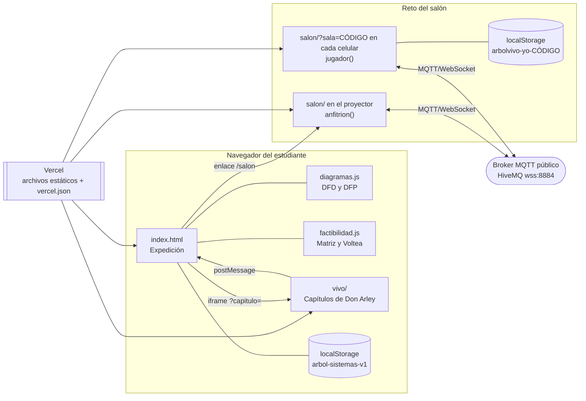
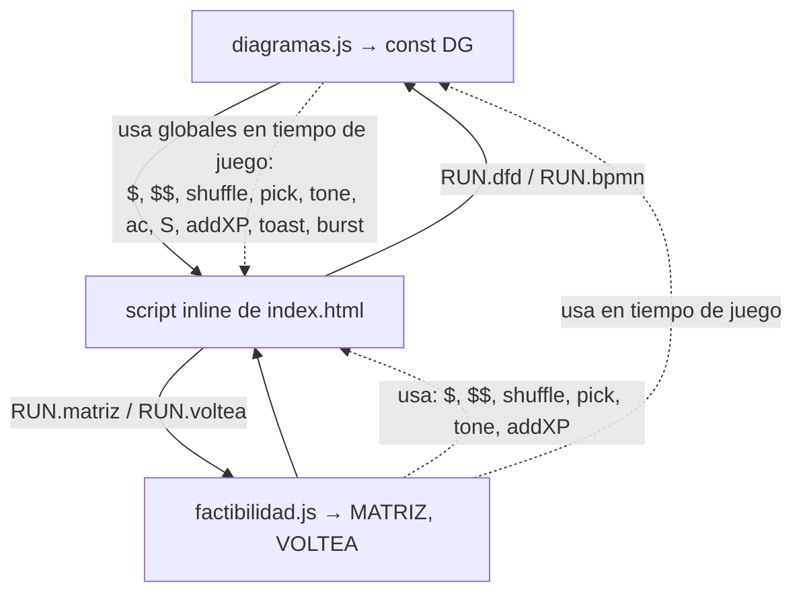
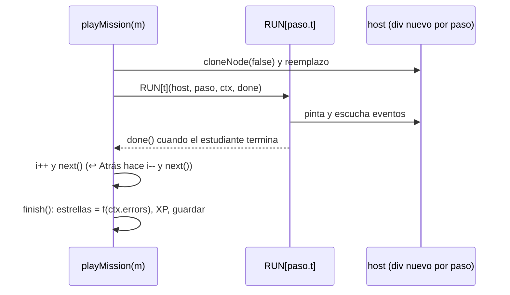
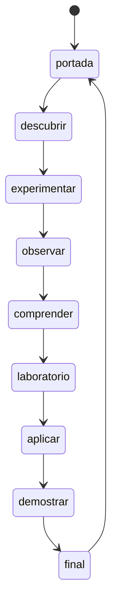
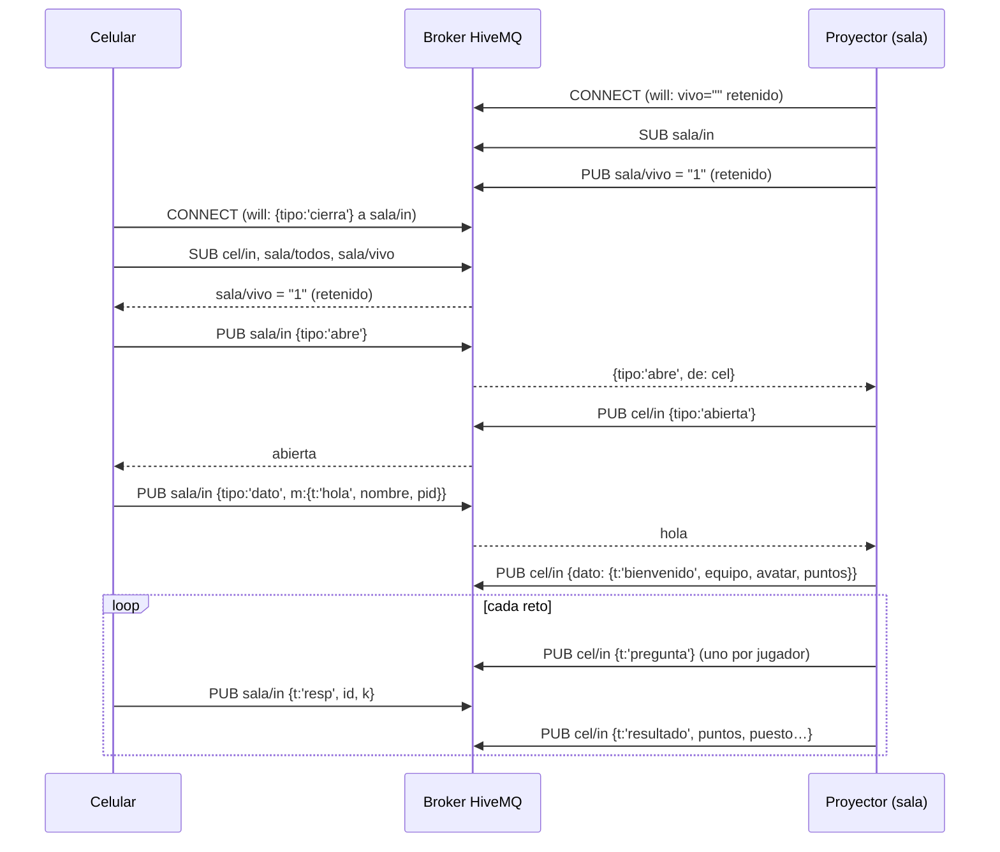
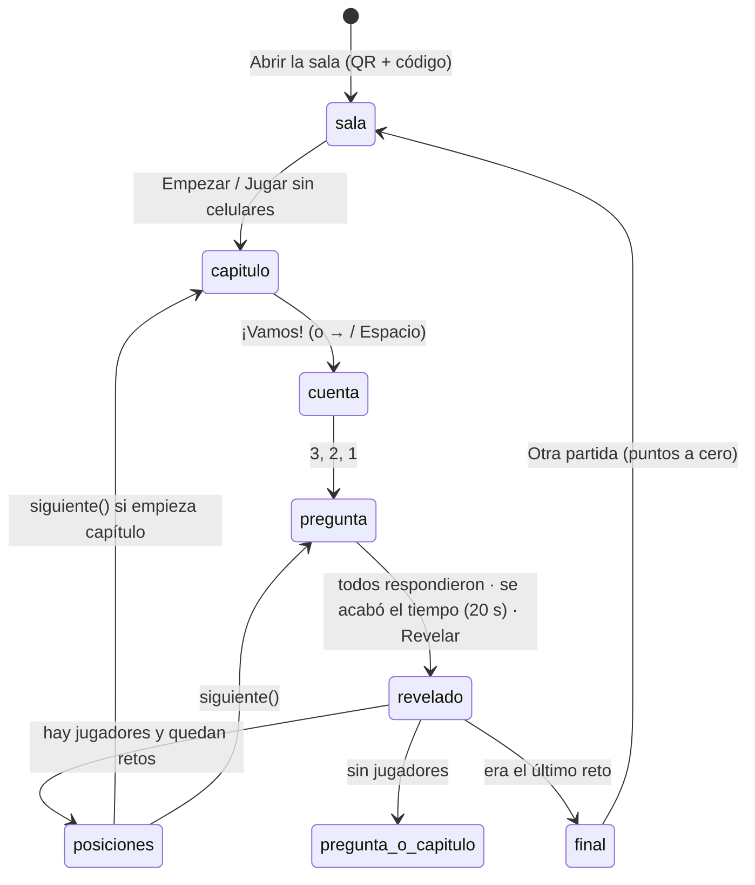
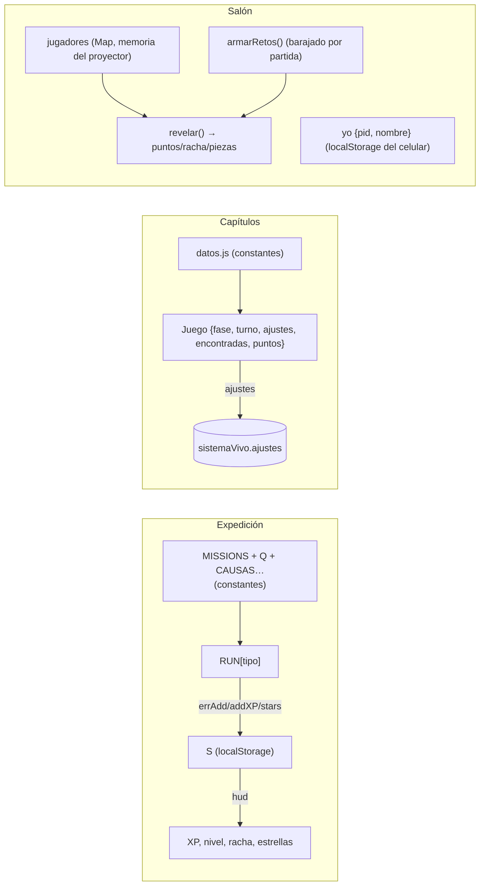

# Mapa técnico y arquitectura

Proyecto de **Juan Pablo Peláez Pino**. Este documento describe cómo está construido el software, tal como está en el commit `dac9c20`. Lo escribió Claude durante la auditoría del 18-11-2026.

## 1. Visión general

- **Tipo:** sitio estático, sin servidor propio ni base de datos. Publicado en Vercel.
- **Tecnología:** HTML, CSS y JavaScript «vanilla» (sin frameworks, sin compilación, sin `package.json`).
- **Dependencias externas (solo en `salon/`):** `mqtt@5.14.1` y `qrcode-generator@1.4.4` desde jsDelivr; broker público `wss://broker.hivemq.com:8884/mqtt`. Fuente Nunito desde Google Fonts en todas las páginas.
- **APIs del navegador:** Canvas 2D, SVG, Web Speech API (síntesis y, en el entrenamiento oculto, reconocimiento), Web Audio API, View Transitions API, Wake Lock API, Vibration API, `localStorage`, `postMessage`, Fullscreen API.



## 2. Estructura de archivos

| Archivo | Líneas | Responsabilidad |
|---|---|---|
| `index.html` | 2323 | Toda la Expedición: estilos inline (líneas 15-413) y script inline (442-2321). Estado, sonido, voz, XP, personajes, contenido (`Q`, `MISSIONS`, `CAUSAS`…), motor de pasos `RUN`, minijuegos, mundo, pantallas, entrenamiento de exposición, reloj de enfoque. |
| `diagramas.js` / `.css` | 441 / 85 | Objeto `DG`: motor de construcción de diagramas en 3 momentos, datos y dibujo del DFD y del DFP estilo Bizagi, efectos `JUGO` (sonido escalonado, carteles, combos). |
| `factibilidad.js` / `.css` | 167 / 53 | `MATRIZ` (reto factible/viable de 4 cuadros) y `VOLTEA` (cartas factibilidad o viabilidad). Usan `DG.JUGO`. |
| `vivo/index.html` | 110 | Escenario de 1600×900 de los capítulos. |
| `vivo/js/datos.js` | 232 | Contenido: componentes, estaciones, 12 fallas, árbol, caso biblioteca, reto, notas del presentador. |
| `vivo/js/util.js` | 210 | `Fases`, utilidades DOM, `Voz`, cortinilla, `sigue(turno)`. |
| `vivo/js/sonido.js` | 38 | `Sonido` con Web Audio. |
| `vivo/js/ruta.js` | 77 | Camino del lote, tablero de 4 columnas, sello. |
| `vivo/js/fases/0…7` | 44-304 | Una fase por archivo: portada, descubrir, experimentar, observar, comprender (+ laboratorio), aplicar, demostrar, final. |
| `vivo/js/juego.js` | 188 | Motor: estado `Juego`, `ir(fase)`, modo capítulo, escala, teclado, ajustes. |
| `salon/index.html` | 27 | Carga librerías y scripts del salón. |
| `salon/canal.js` | 165 | `CanalPeer` y `CanalConexion`: capa de mensajería sobre MQTT que imita la API de PeerJS. |
| `salon/retos.js` | 194 | Contenido del salón: tema árbol y tema factibilidad, capítulos. |
| `salon/salon.js` | 977 | Inicio, proyector (`anfitrion`), celular (`jugador`), animaciones. |
| `salon/salon.css` | 446 | Estilos del salón (proyector y celular). |
| `vercel.json` | 18 | Redirecciones y cabeceras. |
| `docs/` | — | Árbol (PNG y PPTX de 2 diapositivas), mapa de actores (PNG), 3 guías PDF. |

## 3. Orden de carga y dependencias entre módulos



Los dos archivos externos se cargan **antes** del script principal pero solo **definen** cosas; las funciones globales del script principal (`$`, `tone`, `addXP`, `S`…) se usan recién cuando el jugador juega. Es un acoplamiento por variables globales: funciona porque el orden de carga está fijo en `index.html`.

En `vivo/` el orden está comentado en `vivo/index.html`: datos → util → sonido → ruta → fases → juego.

En `salon/`: mqtt.js → qrcode → `canal.js` → `retos.js` → `salon.js`. `retos.js` define `TEMA` leyendo `?tema=factibilidad` y `salon.js` lo usa para elegir retos, capítulos y equipos.

## 4. La Expedición (`index.html`)

### 4.1 Estado

```js
S = {xp, stars:{misión:0-3}, err:[ids], streak, best, tts, fx, noise, vol,
     expoOk, seeds:[], expo:{}, caps:{capítulo:estrellas}, px, moverOk, vozNombre}
```
Se guarda entero en `localStorage['arbol-sistemas-v1']` con `save()` en cada cambio. «Borrar mi progreso» lo reinicia.

### 4.2 Navegación

- `scene(html)` es el «cambio de pantalla»: detiene el mundo, el micrófono y la voz, cierra overlays y pinta `#view`.
- `showMap()` → mundo para caminar (`world()`), herramientas y lista de misiones.
- `playMission(m)` → pasos de la misión; `finish()` calcula estrellas y muestra la siguiente misión (y la invitación al salón en factibilidad y jefe: `salonInv()`).
- `SCREENS`: fichas, árbol, errores, capítulo, clase, mover, expo.
- Al cargar: `#entrenamiento` abre el entrenamiento de la exposición; si no, el mapa.

### 4.3 Motor de pasos



Tipos de paso: `talk`, `sort` (despacha por `modo`: `enlazar`, `armar`, `lanzar`; sin modo → `lluvia`), `order`, `match`, `tf`, `catch`, `memory`, `speed`, `battle`, `build`, `dfd`, `bpmn`, `matriz`, `voltea`.

Pasos agregados después de declarar `MISSIONS` (en el mismo archivo): `addBefore()` inserta catch, memory y speed antes de la batalla; un bloque asigna los `modo` de clasificación y otro reemplaza los primeros pasos del jefe por `build` y `speed`.

### 4.4 Renderizado y bucles

| Componente | Técnica | Bucle |
|---|---|---|
| Mundo para caminar | Canvas 2D con parallax, estaciones, semillas, minimapa | `requestAnimationFrame`, `dt` limitado a 0,05 s |
| Lluvia, lanzamiento, canasta | Canvas 2D | idem |
| Enlazar | DOM + SVG de hilos (curvas Bézier) | eventos de puntero |
| Armar / construir el árbol | DOM con arrastre (fantasma) y `desplazaAlArrastrar` | eventos de puntero |
| DFD / DFP | SVG generado; `animateMotion` para el «paquete» que viaja | redibujo por estado |
| Relámpago, Ceibita dice, entrenamiento | DOM | `setInterval` |

La pausa reemplaza `window.requestAnimationFrame` y `window.setInterval` por versiones que no avanzan mientras `PAUSADO` es verdadero. `setTimeout` no se pausa.

### 4.5 Voz y sonido

- `speak`, `hush`, `leerBloques(bloques)`: cada bloque es una frase en la cola de `speechSynthesis`; `onstart` ilumina el elemento (clase `leyendo`).
- Elección de voz por puntaje: «natural/online/neural» +100, es-CO +30, es-MX/US/419 +20, es-ES +10, Google +15. Se guarda la elegida en `S.vozNombre` y `vivo/` la reutiliza.
- Se quitan emojis antes de leer.
- `tone(tipo)`: secuencias de osciladores. `DG.JUGO.chispa(n)` sube el tono con el combo.

## 5. Capítulos (`vivo/`)



- `Juego.ir(fase)` incrementa `Juego.turno`, limpia el lienzo y muestra una cortinilla. Las animaciones asíncronas preguntan `sigue(turno)` y se detienen solas si cambió la fase.
- **Modo capítulo:** `?capitulo=viaje|camino|arbol|otro|reto` limita las fases; al salir de ellas, `terminarCapitulo()` calcula estrellas (aciertos a la primera) y avisa al padre con `postMessage({origen:'sistema-vivo', tipo:'capitulo', estrellas})`. El padre (`SCREENS.capitulo`) solo acepta mensajes de su propio iframe y guarda `S.caps`.
- El escenario mide siempre 1600×900 y se escala con una variable CSS (`--escala`).

## 6. Reto del salón (`salon/`)

### 6.1 Capa de mensajería (`canal.js`)

| Tema MQTT | Uso | QoS / retenido |
|---|---|---|
| `arbolvivo/v2/<id>/in` | Buzón de cada participante (sala o celular) | QoS 1 |
| `arbolvivo/v2/<idSala>/vivo` | `"1"` sala abierta, `""` cerrada | retenido; también es el *last will* de la sala |
| `arbolvivo/v2/<idSala>/todos` | Difusión de la sala a todos los celulares (chat) | QoS 1 |

`idSala = "arbolvivo-salon-" + código de 4 caracteres` (alfabeto sin 0/O/1/I/L). Al abrir, la sala revisa durante 900 ms si el código ya está en uso; si lo está, genera otro.

Cada mensaje del buzón es `{de, tipo:'abre'|'abierta'|'dato'|'cierra', m}`. `CanalConexion.send(m)` publica `{tipo:'dato', m}` en el buzón del otro.



Tiempos del celular: 5 s para recibir `vivo="1"` después de suscribirse (si no, «No encontramos la sala»), reintento de ruta a los 8 s (máx. 2), abandono a los 25 s («No se pudo entrar»), reconexión con espera creciente (0,6 s + 0,4 s por intento, máx. 4 s) hasta 60 intentos.

### 6.2 Protocolo de la aplicación

| Mensaje `t` | De → a | Contenido |
|---|---|---|
| `hola` | celular → sala | nombre (≤14), `pid` |
| `bienvenido` | sala → celular | tema, nombre, avatar, equipo, puntos, chat, `vuelve` |
| `capitulo` / `cuenta` | sala → celulares | número, ícono, título, texto |
| `pregunta` | sala → celular | id, n, total, título, texto, tipo y opciones (o items/izq/der) |
| `esperar` | sala → celular | ya respondió (al reconectar) |
| `resp` | celular → sala | id del reto y `k` (opción) o `sel` (lista) |
| `avance` | celular → sala | selección parcial (juegos de clasificar, hoy sin uso) |
| `resultado` | sala → celular | ok, ganó, puntos, puesto, racha, puesto del equipo, porqué, correcta |
| `fin` | sala → celular | puesto, puntos, piezas, equipo ganador |
| `chat` / `chat-estado` | ambos | texto limpio (≤60) / encendido |
| `reac` | celular → sala | emoji de la lista fija |

### 6.3 Ciclo de una partida (proyector)



### 6.4 Reglas de puntaje (`revelar()`)

- `fraccion`: 1 si acertó (en juegos de lista, proporción de fichas bien).
- `gano = round((500·f + (f==1 ? 500·max(0, 1 − ms/límite) + 100·max(0, racha−1) : 0)) · (último ? 2 : 1))`.
- Pieza del árbol: `viva` si el promedio del salón ≥ 0,5; si no, `floja`.
- Equipo: promedio de puntos de sus integrantes. Asignación: equipo con menos gente.
- Premios del final: equipo ganador, más rápido (promedio con ≥3 aciertos) y mejor racha (≥2).

### 6.5 Persistencia y recuperación

- El proyector guarda todo en memoria (`Map jugadores`). Cada jugador guarda `ultimoMsg`: si vuelve, se le reenvía la pantalla donde iba (o la pregunta en curso).
- El celular guarda `{pid, nombre}` en `localStorage['arbolvivo-yo-'+código]` y, si existe, entra directo.

## 7. Gestión de datos y estados (resumen)



## 8. Seguridad, rendimiento, compatibilidad y accesibilidad

- **Seguridad:** ver riesgos R1, R2 y R6 del Informe de auditoría. Cabeceras: solo `nosniff` y `Cache-Control: max-age=0, must-revalidate` (no hay CSP). `postMessage` del capítulo usa `'*'` como destino pero el padre valida la fuente; el contenido no es sensible.
- **Rendimiento:** sin imágenes en el juego (todo vectorial o canvas); animaciones de `transform`/`opacity`; `devicePixelRatio` limitado a 2; reacciones limitadas a 40 en pantalla; confeti de 220 partículas por 5 s. `index.html` pesa ~257 KB sin comprimir.
- **Compatibilidad:** respaldo de `webkitAudioContext`, `CSS.supports('offset-path')`, View Transitions opcional, Wake Lock opcional. El reconocimiento de voz del entrenamiento solo funciona en Chrome/Edge (el código lo avisa).
- **Accesibilidad:** `prefers-reduced-motion`, controles de teclado en casi todo, `aria-live` en retroalimentación, `aria-label` en botones de ícono, figuras además de colores en las opciones del salón (▲ ◆ ● ■). Pendiente de auditar con lector de pantalla; los minijuegos de canvas no tienen alternativa textual completa (lanzamiento acepta teclas 1-5; lluvia acepta 1-5).

## 9. Escalabilidad

- El proyector envía cada pregunta y cada resultado **uno por jugador** (QoS 1); con 50 jugadores son ~100 publicaciones por reto, poco para MQTT.
- El cuello de botella real es el **broker público compartido**: sin acuerdo de servicio, latencia variable (medida hoy hasta 27 s para suscribir).
- Todo el estado vive en una pestaña: escala bien para un salón, no para varias salas coordinadas.
