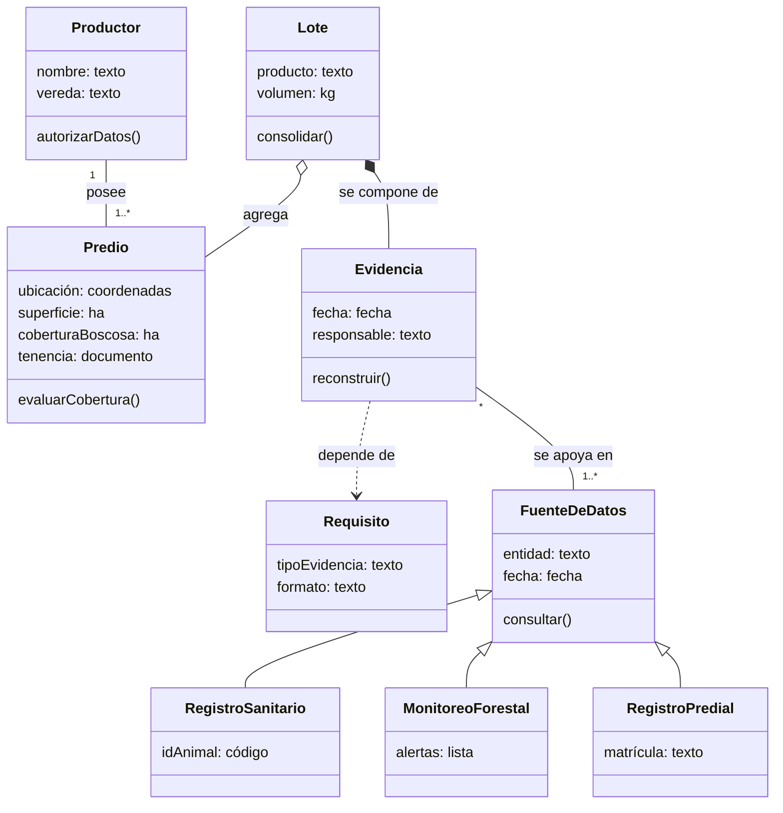
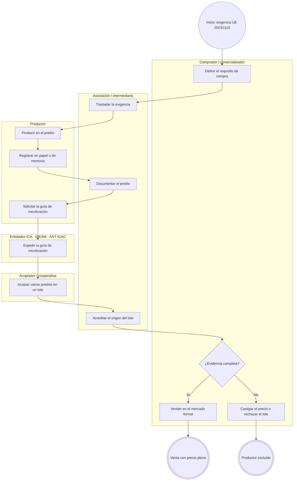
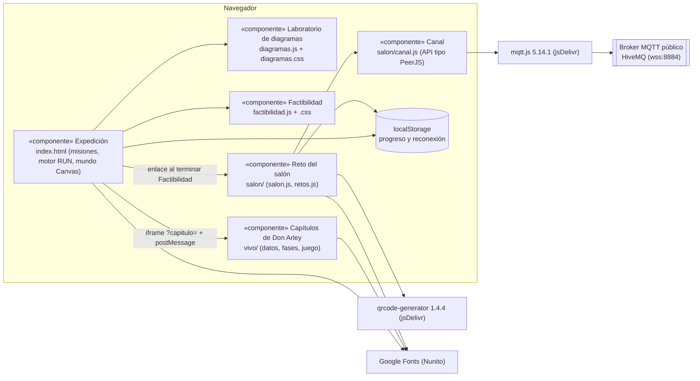
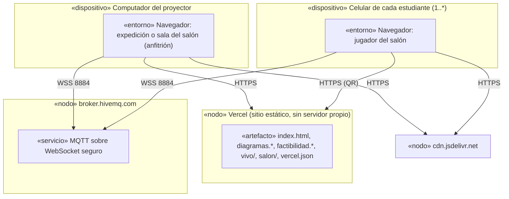

# Diagramas del proyecto: flujo, DFD, DFP y UML

Proyecto de curso **Pasaporte Verde del Predio Amazónico** (Juan Pablo Peláez Pino y Brahiam Parra Bolaños) y juego **Árbol de Problemas · Expedición** (Juan Pablo Peláez Pino). Análisis de Sistemas, Ingeniería de Sistemas, Universidad de la Amazonia.

Los archivos `.svg` salen del **mismo código del juego** (`diagramas.js`): lo que se ve aquí es lo que el estudiante construye en las misiones. Los diagramas de actividades, componentes y despliegue están en Mermaid (GitHub los dibuja solos).

## Fuentes de cada diagrama

| Fuente | Qué aporta |
|---|---|
| Material del curso (Clase 3 y «Casos de uso UML», «Diagrama de clases») | Símbolos del diagrama de flujo (Inicio/Fin, Actividad, Decisión, Flujo), BPMN/Bizagi, AS-IS, cuellos de botella; actor, caso de uso, límite del sistema, «include», «extend», plantilla de descripción; clase con nombre/atributos/métodos y las 5 relaciones |
| Propuesta *Pasaporte Verde del Predio Amazónico* (sept. 2026) | 6 procesos y responsables (§5.2), variables (§5.5), requisitos RI-01 a RI-10, reglas R-01 a R-04, lineamientos L-01 a L-07, modelos a elaborar (§8.4) |
| `pasaporte-verde-asis.bpmn` y `pasaporte-verde-tobe.bpmn` (Bizagi, 30-oct-2026) | Carriles, tareas, compuerta y eventos del proceso de hoy y del propuesto |

## Mapa de diagramas

| # | Diagrama | Estado | Notación | En el juego | Archivo |
|---|---|---|---|---|---|
| 1 | Diagrama de flujo del proceso | AS-IS | Diagrama de flujo (curso) | Misión 5 «Procesos» | [01_diagrama_de_flujo_AS-IS.svg](01_diagrama_de_flujo_AS-IS.svg) |
| 2 | DFD nivel 0 (contexto) | AS-IS | Yourdon/DeMarco | Misión 6 «DFD», explicación | [02_DFD_nivel_0_contexto.svg](02_DFD_nivel_0_contexto.svg) |
| 3 | DFD nivel 1 | AS-IS | Yourdon/DeMarco | Misión 6 «DFD», minijuego | [03_DFD_nivel_1.svg](03_DFD_nivel_1.svg) |
| 4 | DFP con carriles | AS-IS | BPMN 2.0 (Bizagi) | Misión 7 «DFP», minijuego | [04_DFP_BPMN_AS-IS.svg](04_DFP_BPMN_AS-IS.svg) |
| 5 | Casos de uso | TO-BE | UML | Misión 14 «UML», minijuego 1 | [05_UML_casos_de_uso.svg](05_UML_casos_de_uso.svg) |
| 6 | Diagrama de clases (modelo conceptual) | TO-BE | UML | Misión 14 «UML», minijuego 2 | [06_UML_diagrama_de_clases.svg](06_UML_diagrama_de_clases.svg) |
| 7 | Actividades del proceso | AS-IS | UML (Mermaid) | — (es el mismo proceso del 1 y el 4) | abajo |
| 8 | Componentes del juego | Software | UML (Mermaid) | — | abajo |
| 9 | Despliegue del juego | Software | UML (Mermaid) | — | abajo |

Cada diagrama usa **una sola notación**. El diagrama de flujo, el DFD y el DFP describen el sistema **de hoy** (AS-IS), igual que el árbol de problemas; los de UML describen lo que el sistema propuesto **debe hacer** (TO-BE).

### Flechas del DFD nivel 1

| N.º | De → A | Dato |
|---|---|---|
| 1 | Productor → 1 Documentar el predio | Datos y documentos del predio |
| 2 | Entidades de registro → 1 Documentar el predio | Registros sanitarios y de tierra |
| 3 | 1 Documentar el predio → Documentos del predio | Carpeta del predio |
| 4 | Productor → 2 Acopiar el producto | Producto cosechado |
| 5 | 2 Acopiar el producto → Registros de acopio | Lote y volumen |
| 6 | Documentos del predio → 3 Acreditar el origen | Documentos del predio |
| 7 | Registros de acopio → 3 Acreditar el origen | Datos del lote |
| 8 | 3 Acreditar el origen → 4 Comercializar | **Evidencia de origen (incompleta)** |
| 9 | Comprador → 4 Comercializar | Exigencia y pedido |
| 10 | 4 Comercializar → Comprador | Producto y evidencia |

El nivel 1 está **balanceado** con el nivel 0: las mismas 3 entidades y los mismos flujos de entrada y salida. Producir y Movilizar no transforman datos del sistema de acreditación en este nivel; se ven en el diagrama de flujo y en el DFP.

## Casos de uso (formatos del curso)

### Listado de actores

| N.º | Actor (rol) | Usuario | Comentario |
|---|---|---|---|
| 01 | Productor | Pequeño productor del Caquetá | Actor principal: el dato nace en su predio y la información es suya (RI-09) |
| 02 | Asociación / gremio | Comité de Ganaderos, ASOHECA… | Acompaña el registro y orienta la subsanación |
| 03 | Acopiador / cooperativa | — | Consolida el lote conservando el origen (RI-04) |
| 04 | Comprador / comercializador | — | Define el requisito (RI-05) y consulta el expediente |
| 05 | Entidades públicas | IDEAM, ICA (SINIGAN), ANT-IGAC | Actor secundario: entregan los datos (L-02) |

La **autoridad competente** certifica (R-03) y por eso queda **fuera** del límite del sistema.

### Listado de casos de uso

| Código | Caso de uso | Actor | Trazabilidad |
|---|---|---|---|
| CU01 | Consultar el requisito en su lenguaje | Productor | RI-07, L-03 |
| CU02 | Registrar el requisito de compra | Comprador | RI-05 |
| CU03 | Registrar el predio y su producción | Productor, Asociación | RI-01, RI-06, L-01, L-04 |
| CU04 | Autorizar el uso de sus datos | «include» de CU03 | RI-09, Ley 1581 de 2012 |
| CU05 | Evaluar el predio frente a la línea base | Productor | RI-02, R-01 |
| CU06 | Consultar fuentes públicas | «include» de CU05; Entidades públicas | RI-03, L-02 |
| CU07 | Orientar la subsanación | «extend» de CU05; Asociación | carril Asociación del TO-BE |
| CU08 | Consolidar el lote con su origen | Acopiador | RI-04, R-04, L-06 |
| CU09 | Consultar el expediente del lote | Comprador | RI-08, L-05 |

Cada caso corresponde a una tarea del carril «Pasaporte Verde (sistema)» o de un actor del BPMN TO-BE. RI-10 (indicadores, L-07) es un requisito del sistema completo y no se modeló como caso de uso de un actor en esta versión.

### Descripción del caso de uso CU05

| Campo | Contenido |
|---|---|
| Identificador | CU05 |
| Nombre | Evaluar el predio frente a la línea base |
| Actores | Productor (principal); Entidades públicas (secundario, por CU06) |
| Resumen | El sistema compara la cobertura boscosa del predio con la línea base del 31-12-2020 y muestra el resultado al productor. |
| Precondición | El predio está registrado (CU03) y el productor autorizó el uso de sus datos (CU04). |
| Curso básico | 1. El productor pide evaluar su predio. 2. El sistema consulta las fuentes públicas («include» CU06). 3. El sistema compara la cobertura con la línea base. 4. El sistema muestra el resultado en el lenguaje del productor (RI-07). 5. El sistema guarda el resultado con su fuente y su fecha (R-02). |
| Camino alternativo | 3a. Si hubo pérdida de cobertura después de la línea base, el predio no se acredita (R-01) y se orienta la subsanación («extend» CU07). |
| Camino de excepción | Sin señal: el registro se guarda en el predio y se sincroniza después (RI-06). |
| Postcondición | El predio queda evaluado, con fuente y fecha (R-02). |

## Diagrama de clases (modelo conceptual)

Las clases son los sustantivos del análisis (§8.4: predio, productor, lote, evidencia) más el requisito (RI-05) y las fuentes (R-02). Los atributos son las variables de §5.5. Es un modelo **conceptual**, no el diseño de una base de datos.

| Relación del curso | Dónde aparece |
|---|---|
| Asociación | Productor posee Predio; Evidencia se apoya en FuenteDeDatos |
| Agregación (◇) | Lote agrega Predio: el predio existe sin el lote |
| Composición (◆) | Lote se compone de Evidencia: la evidencia no existe sin el lote |
| Generalización (△) | RegistroSanitario, MonitoreoForestal y RegistroPredial son FuenteDeDatos |
| Dependencia (⇢) | Evidencia depende de Requisito |

## Diagrama de actividades (AS-IS)

Es el mismo proceso del DFP, con particiones por actor (UML 2).

Cuello de botella (Clase 3): «Acreditar el origen del lote» depende de la asociación y de papeles dispersos; ahí se acumulan esperas.

## Diagrama de componentes del juego

## Diagrama de despliegue

El broker es público: los nombres y el chat del salón viajan por él. Por eso la sala pide usar solo el primer nombre o un apodo, y el celular escapa todo lo que llega por la red antes de mostrarlo.
